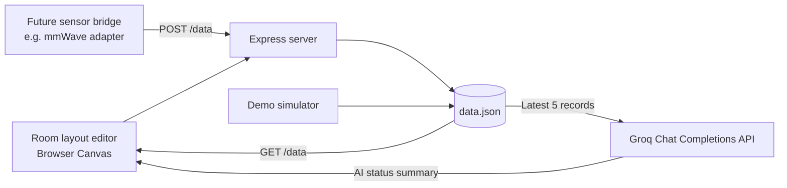

# SafeNet

A small child-safety monitoring prototype with a room-layout editor, a JSON-based sensor data feed, and an AI-generated status summary. The idea is to bring basic room context and recent activity data into one dashboard, then use an LLM to turn the latest readings into something easier to interpret.

This is still a prototype, not a finished monitoring product. In particular, the archive doesn't contain the actual mmWave sensor drivers or hardware integration, so the included simulator is what produces demo readings right now.

## What it does

- Lets you sketch a room layout on a grid. Each grid square represents one metre.
- Lets you mark rooms, doors, and restricted areas on the canvas.
- Displays the latest movement and heart-rate fields from the local data feed.
- Keeps a short rolling history of sensor-style records in a local JSON file.
- Can generate a short trend summary from the five latest records using Groq.
- Includes a simulator so the dashboard can be explored without connecting hardware.

## Stack

- **Node.js + Express** – serves the web app and exposes the data and analysis endpoints.
- **HTML, CSS, JavaScript, Canvas API** – the dashboard and room-layout editor.
- **JSON file storage** – a simple local history store for this prototype.
- **Groq API** – generates the natural-language status summary.
- **`simulator.js`** – creates synthetic readings for development and demos.

## Architecture



### How the pieces fit together

1. **The browser** draws the floor plan and polls the backend for the latest monitoring record. The floor-plan editor currently keeps its room, door, and restricted-area drawing state in browser memory; it doesn't save the layout to the server yet.
2. **The Express server** serves the static frontend, reads and writes the monitoring history, and exposes `/data`, `/analyze`, and `/health` routes. There is also a `POST /data` endpoint that a separate sensor process can use to submit a reading.
3. **The data file** stores a rolling history of up to 20 records. The server creates `data.json` automatically the first time it is needed. It is intentionally excluded from Git because it contains runtime data.
4. **The simulator** generates a new synthetic record every three seconds. It changes the simulated position, movement state, and heart-rate value, and occasionally generates a simulated fall event.
5. **The AI analysis route** sends the latest five records to Groq and asks the model for a short trend summary and one of the prototype risk labels.

## Project structure

```text
SafeNet/
├── public/
│   ├── index.html       # Dashboard markup
│   ├── script.js        # Canvas editor and backend polling
│   └── style.css        # Dashboard styling
├── .env.example         # Environment variable template
├── .gitignore
├── data.example.json    # Empty example of the data file format
├── package.json
├── package-lock.json
├── README.md
├── server.js            # Express API and Groq integration
└── simulator.js         # Synthetic sensor-data generator
```

## Run it locally

You'll need **Node.js 22.9 or newer** and npm.

```bash
# 1. Install dependencies
npm install

# 2. Create your local environment file
# Windows PowerShell:
Copy-Item .env.example .env
# macOS / Linux:
cp .env.example .env

# 3. Add your Groq API key to .env if you want AI summaries

# 4. Start the web server
npm start
```

Open [http://localhost:3000](http://localhost:3000).

### Start the demo simulator

Open a second terminal in the project directory and run:

```bash
npm run simulate
```

It writes a new synthetic reading every three seconds. Leave it running while you use the dashboard. Stop it with `Ctrl+C`.

The dashboard and simulator can be run without a Groq key, but the AI panel won't produce model-generated summaries until `GROQ_API_KEY` is configured.

## Environment variables

| Variable | What it does | Default |
|---|---|---|
| `GROQ_API_KEY` | API key used for AI analysis | Not set |
| `GROQ_MODEL` | Groq model ID | `openai/gpt-oss-20b` |
| `PORT` | HTTP server port | `3000` |
| `DATA_FILE` | Path to the local JSON history file | `./data.json` |

The original code used `llama-3.1-8b-instant`. That model was deprecated for developer-tier use, so the default has been moved to Groq's recommended replacement, `openai/gpt-oss-20b`. You can change it through `GROQ_MODEL` if needed. See the [Groq model documentation](https://console.groq.com/docs/models) and [deprecation notes](https://console.groq.com/docs/deprecations).

## API routes

### `GET /health`

Simple server health check.

### `GET /data`

Returns the current rolling history:

```json
{
  "history": []
}
```

### `POST /data`

Accepts a new record from a separate sensor adapter or local data producer. The current repository doesn't contain the hardware adapter itself.

Example request:

```bash
curl -X POST http://localhost:3000/data \
  -H "Content-Type: application/json" \
  -d '{
    "current": { "x": 2, "y": 3 },
    "moving": 1,
    "falling": 0,
    "heartRate": 88
  }'
```

The `current.x` and `current.y` values must be between 1 and 4. `moving` and `falling` can be `0`, `1`, `false`, or `true`. `timestamp` and `previous` are optional; the server fills them in when omitted.

### `GET /analyze`

Reads the last five records and asks Groq to return a short natural-language summary and a prototype risk label. If the API key is missing or the provider request fails, the endpoint reports that AI analysis is unavailable; it does not turn a software error into a risk assessment.

## Data format

Each record has this general shape:

```json
{
  "timestamp": 1767778329335,
  "current": { "x": 2, "y": 3 },
  "previous": { "x": 1, "y": 3 },
  "moving": 1,
  "falling": 0,
  "heartRate": 88
}
```

The position values are a simplified representation used by this prototype. They are not yet derived from a real mmWave tracking pipeline in this repository.

## Current limitations / next steps

A few things are deliberately worth calling out so the project is easy to understand honestly:

- **No physical mmWave integration is included here.** There is no sensor SDK, serial reader, or two-sensor fusion module in this archive. `POST /data` is an ingestion point for a future sensor bridge, while `simulator.js` is only for synthetic data.
- **Restricted-zone checking isn't connected to sensor positions yet.** The UI currently shows this as `NOT CONNECTED` rather than claiming the room is safe.
- **The floor plan isn't persisted.** Room, door, and restricted-area drawings live in the browser session and are reset when the page is reloaded.
- **The AI output is not a diagnosis.** It is generated text based on a small window of input records and may be wrong or overconfident.
- **There is no authentication or production hardening.** Keep this as a local demo until access control, secure transport, sensor validation, reliability testing, and appropriate alerting are implemented.

## Security notes

- Never commit `.env` or paste your Groq key into source code.
- The `.gitignore` excludes local secrets and generated `data.json` history.
- Only the latest five records are sent to Groq for analysis.
- If a key was ever committed or shared, revoke it in Groq and create a fresh one. Removing it from the current files doesn't invalidate an already exposed key.

---

Built as a prototype to explore how room context, movement readings, and AI-generated summaries could fit together in a child-safety monitoring workflow.
